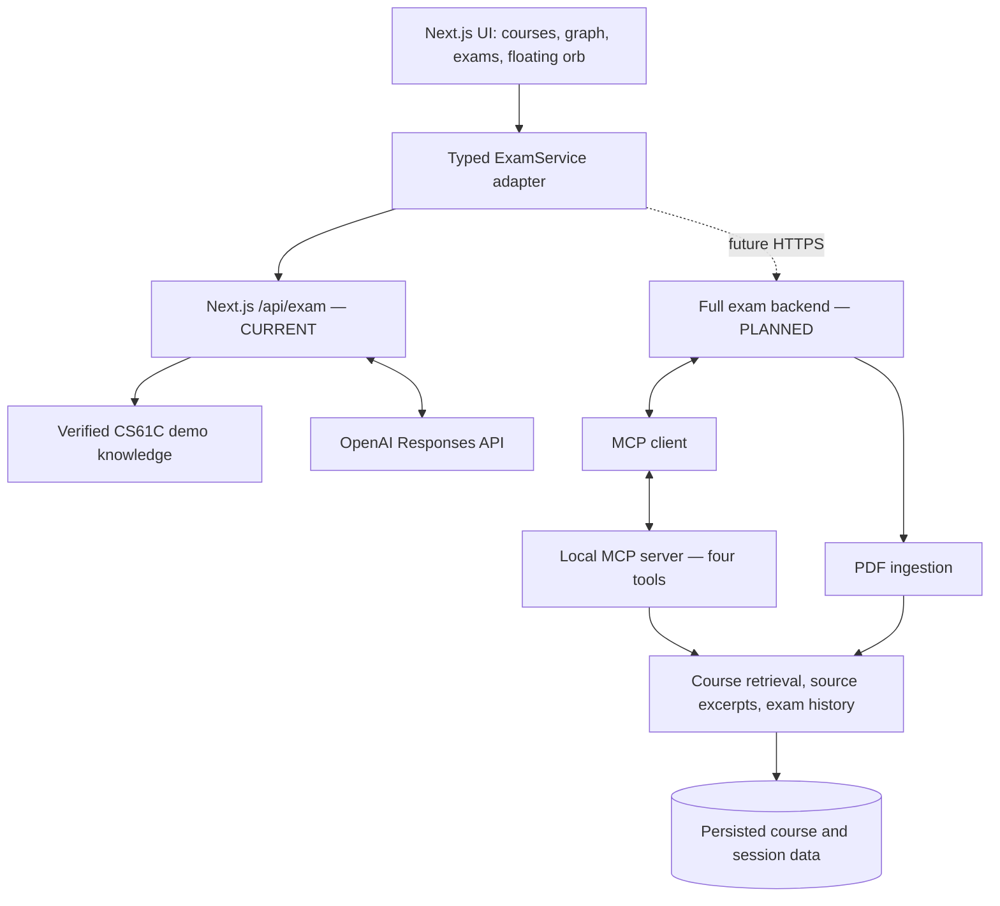

Connected Oral Exam — AI-Assisted Oral Examination Practice
Current status: Interactive prototype with a narrow server-side OpenAI examiner integration. Questions, reasoning feedback, and adaptive follow-ups use the OpenAI Responses API when `OPENAI_API_KEY` and `OPENAI_MODEL` are configured. The examiner is bounded to a small, verified UC Berkeley CS61C Computer Architecture demo knowledge base. PDF understanding, MCP, authentication, databases, and real course-material retrieval are not connected.

What are we building?
Connected Oral Exam helps university students prepare for questions that combine ideas from multiple chapters. Many students can recall isolated facts but struggle when professors ask them to relate concepts, explain tradeoffs, or reason through unfamiliar examples.

Problem statement: “I was preparing to remember what I had studied, but my professors were testing whether I could think with what I had learned.”

Target users: University students preparing for oral examinations, initially engineering and other concept-heavy subjects. Secondary audience: tutors/mentors reviewing progress or the concept.

Value proposition: Practice connected reasoning, not just memorization.
Product experience
The student enters a polished web study workspace, manages courses and lecture materials, views conceptual connections, and invokes a floating Siri-inspired voice assistant orb at the bottom corner. The orb opens an interactive assistant while the workspace remains visible. The student can say or type “Test me,” receive an oral-exam question connecting chapters, answer in text or optional voice, then get AI practice feedback and an adaptive follow-up grounded in the verified demo knowledge base.

Prototype now: The exam journey uses model-generated questions and practice feedback grounded only in identified public demo sources. Graphs, course previews, prior sample history, and uploaded-file controls remain local demo UI. The system does not claim to read newly selected PDFs.
Core user journey
1. Open dashboard → choose a course or create one.
2. Add or choose chapters/PDFs. Frontend phase: upload controls only queue/select file names locally; no ingestion.
3. Explore an example concept graph showing linked chapters.
4. Tap floating assistant → “Test me.”
5. Receive an AI-generated cross-chapter question grounded in the verified demo knowledge base.
6. Speak using supported browser speech input or type an answer; explicitly submit.
7. Receive AI practice feedback and an adaptive follow-up.
8. Continue or end session; view a demo recap and history.
Tech stack
Current frontend (build now)
- Next.js App Router, React, TypeScript
- Tailwind CSS + shadcn/ui
- Motion animation library and Lucide icons
- React context or Zustand for UI/session state
- Local fixture data and optional localStorage for non-sensitive preferences and demo history
- Optional browser Web Speech API for user-triggered speech recognition and speech synthesis; text works everywhere
- Next.js Node.js route handler at `/api/exam` using the official OpenAI JavaScript SDK and Responses API
- Server-only `OPENAI_API_KEY` and configurable `OPENAI_MODEL`; neither is exposed to client bundles
Planned backend (do not implement in frontend phase)
- Python + FastAPI HTTP endpoints for courses, uploaded documents, exams, feedback and history
- PyMuPDF ingestion to extract PDF pages, preserve file/page/chapter metadata, and identify limitations for image-heavy slides; image understanding/OCR later
- Retrieval service that locates relevant source excerpts from at least two chapters; initially simple search, later embeddings and pgvector if justified
- Deterministic Python exam orchestrator (finite-state workflow), limited retrieval and model calls, structured question/feedback validation
- Configurable LLM provider (OpenAI-compatible endpoint such as OpenRouter or OpenAI)
- Local Python MCP server + client, using official SDK, exposing these four read-only tools:
  - search_course_material
  - find_concept_connections
  - get_slide_context
  - get_exam_history
- Initial persistence: local JSON/SQLite for small prototype; PostgreSQL when shared accounts, concurrency, or richer retrieval is needed
- Guardrails: check source IDs and chapter diversity; treat PDF text as untrusted; cap tool calls; never invent evidence or claim that generated feedback is a certified exam grade
Architecture

MCP’s role: tools make course material and history available to the orchestrator/LLM workflow. MCP does not generate questions by itself. The LLM produces questions; the orchestrator handles state, source validation, and bounded tool use.
Repository docs and source of truth
File	Purpose	Status
[`README.md`](README.md)	Overall product, phased architecture, development setup	Current
[`docs/UI_SPEC.md`](docs/UI_SPEC.md)	Detailed frontend behavior, components, interactions, visual rules and acceptance checks	Frontend source of truth
[`AGENTS.md`](AGENTS.md)	Instructions and constraints for Codex coding sessions	Current
[`docs/ARCHITECTURE.md`](docs/ARCHITECTURE.md)	Earlier Python/MCP architecture; useful for backend tool design	Backend reference only; Streamlit frontend superseded
`docs/IMPLEMENTATION_PLAN.md`	Earlier quick full-stack build plan (not currently present)	Superseded for current frontend-first milestone

If files conflict, UI_SPEC.md + this README + AGENTS.md govern current frontend development. For the later backend, retain the agreed local MCP tool contracts but revisit old estimates and storage choices.
Suggested project layout
connected-oral-exam/
  README.md
  UI_SPEC.md
  AGENTS.md
  ARCHITECTURE.md                 # legacy backend reference
  IMPLEMENTATION_PLAN.md         # superseded full-stack sprint
  package.json
  src/
    app/                         # Next.js App Router pages
    components/                  # shell, floating orb, assistant, courses, exam
    lib/                         # types, fixtures, demo service, speech helpers
    store/                       # local session/preferences state
  public/
  backend/                       # later only; not created for UI sprint
Local development
npm install
cp .env.example .env.local
# set OPENAI_API_KEY and OPENAI_MODEL in .env.local
npm run dev
# open http://localhost:3000
npm run lint
npm run typecheck
npm test
npm run build
Use Node.js LTS compatible with the chosen Next.js release. Both `OPENAI_API_KEY` and `OPENAI_MODEL` are required for live exam turns. Keep them server-side and never use a `NEXT_PUBLIC_` prefix.
Frontend delivery milestone
- A professionally styled, responsive workspace (dashboard, courses, graph, exam, history, settings).
- A floating animated assistant orb that can open and close without losing context.
- “Test me” launches an OpenAI-powered oral exam with answer → AI practice feedback → adaptive follow-up → recap.
- Optional browser microphone capture with explicit permission, support detection, safe fallback and optional speech playback; no automatic audio recording.
- Course creation, chapter selection, pending PDF file selection and demo history all work locally.
- Visible knowledge-boundary labeling distinguishes real AI practice feedback from sample graphs, history, and unprocessed PDFs.
- Basic keyboard accessibility, reduced motion and reliable mobile layouts.
Later milestones (not part of current coding request)
Phase 2: Real content pipeline — Server-side PDF upload, extraction, chapter metadata, verified source previews and retrieval; clearly handle text-poor slides.

Phase 3: MCP and examiner backend — MCP server/client, ExamService HTTP implementation, source-grounded cross-chapter questions, answer evaluation and adaptive follow-ups.

Phase 4: Product reliability — User accounts if needed, secure storage/deletion, measurable question-quality tests, cost and availability controls, better speech mode and richer analytics.
Privacy and limitations
- Selected PDF contents are never sent. Submitted answers go through the local Next.js server route to OpenAI for exam evaluation. Browser speech recognition is optional and may separately use the browser vendor's service.
- Responses are chained with a session-only response ID. The browser does not persist raw answers or response IDs; stored Responses API objects may be retained by OpenAI for up to 30 days.
- Avoid storing raw PDFs, transcript audio or sensitive user data in localStorage. Explicitly mark simulated feedback, graph relationships and exam sources as examples.
- Future real AI outputs can be wrong. Display verifiable page citations and describe scores as practice feedback, not official grading.
- External model processing and data retention will require a clear privacy notice before the backend is enabled.
Demo walkthrough for mentors
1. Show Home: “Most students study chapters separately, but oral exams test the connections.”
2. Open Connections: demonstrate multiple chapters feeding one deeper reasoning question.
3. Tap the glowing bottom-corner orb: “Test me.”
4. Answer by typing (or voice in supported browsers) and display labeled AI practice feedback with verified demo sources.
5. Show the next follow-up and recap, then explain the planned MCP-powered grounded backend.
Success measure today: A mentor understands the user problem, target audience and intended end-to-end experience, while seeing a smooth, honest interactive prototype.
